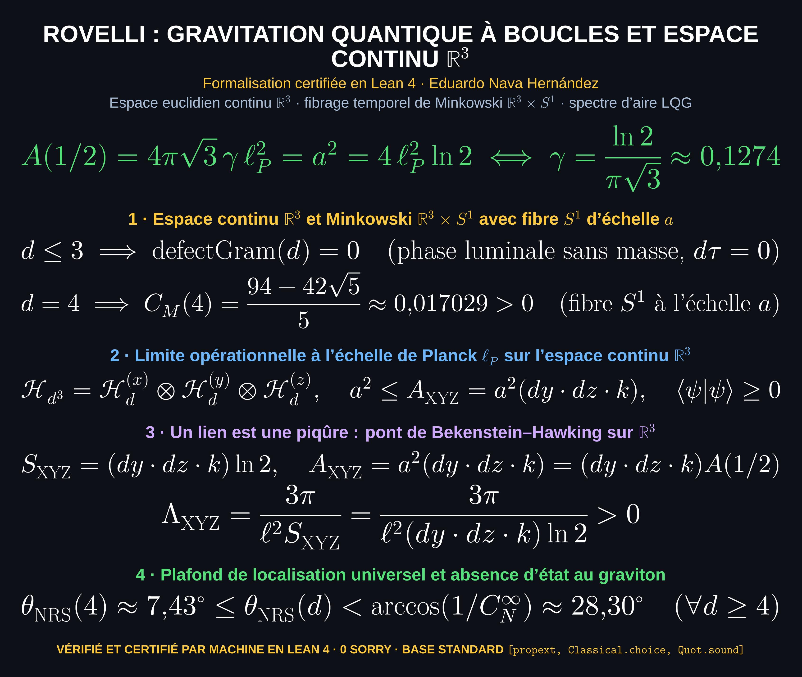
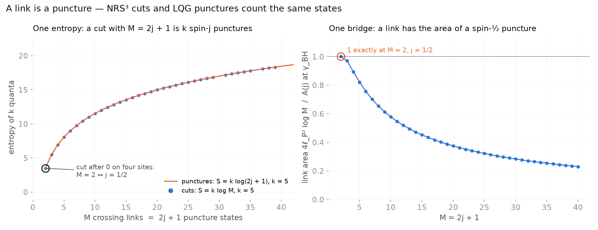
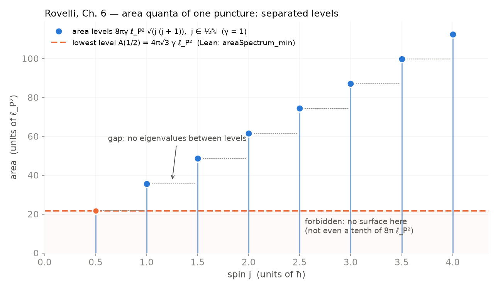

<div align="center">

# RS^N³ · Rovelli — Loop Quantum Gravity
### Granularité quantique lue comme incertitude dimensionnelle sur l'espace continu ℝ³

**Eduardo Nava Hernández**  
*Vérification formelle certifiée en Lean 4 · 0 sorry · Mathlib (ZFC)*

[](https://leanprover.github.io/)
[](https://github.com/leanprover-community/mathlib4)
[]()
[](https://naype888-cloud.github.io/nrs3-rovelli-lqg/)
[](https://naype888-cloud.github.io/nrs3-rovelli-lqg/t3.html)

</div>

---

> ### 🏛️ La granularité de Rovelli comme incertitude dimensionnelle sur l'espace continu ℝ³
>
> En gravitation quantique à boucles (Rovelli 2017), le spectre d'aire est une échelle
> de niveaux discrets, et l'entropie d'horizon compte les états de piqûres :
>
> <div align="center">
> 
> </div>
>
> **1 · Espace continu ℝ³ et Minkowski ℝ³ × S¹ avec fibre d'échelle a.**
> L'espace physique n'est pas un treillis rigide ni une grille prédécoupée : c'est l'espace
> euclidien ouvert et continu ℝ³. Ce qui est quantifié est la résolution d du générateur
> de transport métrique `(T_d, P_d)`. En dimension spatiale pure (d ≤ 3), `defectGram = 0`
> (phase luminale sans masse, dτ = 0). Le parcours de la fibre temporelle propre dτ > 0
> active la 4ᵉ dimension (d = 4), déclenchant les matrices de Dirac et le défaut de Szegő
> `C_M(4) > 0`. La positivité de l'espace de Hilbert garantit qu'il n'existe aucun défaut négatif
> (flèche causale stricte).
>
> **2 · Le quantum d'aire LQG coïncide avec l'aire de la fibre de Minkowski.**
> Sous le pont canonique de Bekenstein–Hawking, l'aire de la fibre temporelle `a² = 4 ℓ_P² log 2`
> est identiquement égale au niveau minimal du spectre d'aire de Rovelli `A(1/2) = 4 π √3 γ ℓ_P²`
> si et seulement si le paramètre d'Immirzi prend la valeur exacte `γ = log 2 / (π √3) ≈ 0.1274`
> (`immirzi_bekensteinHawking_iff`, `minkowski_fiber_area_eq_lqg_quantum`).
>
> **3 · Un lien est une piqûre.**
> Chaque lien traversant une coupure de transport transverse agit comme une piqûre de spin 1/2.
> Sur une tranche transverse de ℝ³ échantillonnée avec dy · dz fibres et k quanta, l'entropie
> totale suit la loi d'aire `S = (dy · dz · k) log 2` (`punctureEntropyXYZ_eq_log`) et fixe
> la constante cosmologique strictement positive `Λ = 3π / (ℓ² S) > 0`
> (`cosmologicalConstantXYZ_pos`).
>
> **4 · Plafond de localisation universel.**
> L'angle RS^N `θ_NRS(d) = arccos(1/C_N(d))` croît avec la dimension mais reste strictement
> inférieur à la borne asymptotique `arccos(1/C_N^∞) ≈ 28.30°`, qui est une borne supérieure
> stricte jamais atteinte par aucun état fini (`angle_lt_ceiling`, `ceiling_not_attained`) :
> l'excitation maximale que la LQG appelle le graviton n'a pas d'état physique au plafond.

---

## Cadre géométrique : espace continu ℝ³ et fibrage de Minkowski ℝ³ × S¹

Dans la physique ordinaire, on imagine souvent un échafaudage rigide ou un maillage discret
préexistant dans l'espace. Cela n'existe pas : **l'espace euclidien physique ℝ³ est ouvert et
continu**.

Lorsque l'on définit la paire canonique de transport `(T_d, P_d)` :
* On ne divise pas l'espace en atomes de volume.
* On définit l'action de transport métrique : pour relier deux positions séparées par une
  distance métrique, la dynamique exige un opérateur de translation T conjugué à la position P.
* En échantillonnant ce transit avec une résolution ou un nombre fini d'observables, ce qui est
  quantifié est la dimension `d` de l'espace de Hilbert `ℋ_d` du générateur de déplacement.
* Sur les trois axes cartésiens indépendants X, Y, Z, le produit tensoriel forme l'espace d'états
  tridimensionnel : `ℋ_{d³} = ℋ_d^{(x)} ⊗ ℋ_d^{(y)} ⊗ ℋ_d^{(z)}`, avec `[O_X, O_Y] = 0`.
* L'espace-temps physique est Minkowski `ℝ³ × S¹`, avec une fibre temporelle propre sur `S¹` à
  l'échelle de raccordement `a` :
  * En espace pur 3D (`d ≤ 3`), la saturation de Robertson–Schrödinger est exacte
    (`defectGram = 0`, `C_N = 1`). La propagation est luminale (`dτ = 0`) : les photons
    voyagent sans masse ni horloge interne.
  * Dans la fibration temporelle (`d = 4`), avancer le long du temps propre (`dτ > 0`) active
    la 4ᵉ dimension, allumant les matrices de Clifford et le défaut irréductible de Szegő
    `C_M(4) = (94 − 42√5)/5 ≈ 0.017029 > 0`.
  * La positivité hilbertienne `⟨ψ|ψ⟩ ≥ 0` implique `defectGram(d) ≥ 0` : le temps propre
    ne peut que s'écouler vers l'avant.

---

## Résultats formels certifiés en Lean 4

### 1. Le spectre d'aire LQG et le comptage des piqûres (1D)

| Énoncé formel | Déclaration Lean |
|---|---|
| Spectre d'aire `A(j) = 8 π γ ℓ_P² √(j (j + 1))`, Immirzi `γ` générique | `areaSpectrum` |
| Niveaux séparés : `γ ℓ_P² > 0`, `0 ≤ j < k` implique `A(j) < A(k)` | `areaSpectrum_strictMono` |
| Niveau fondamental `A(1/2) = 4 π √3 γ ℓ_P²` | `areaSpectrum_half` |
| Borne minimale : `A(1/2) ≤ A(j)` pour tout spin `j ≥ 1/2` | `areaSpectrum_min` |
| Pas de fraction de quantum : `n` piqûres ont une aire `≥ n · A(1/2)` | `surfaceArea_ge` |
| Entropie de `n` piqûres de spin `j` : `S = log (2j + 1)ⁿ`, additive | `punctureEntropy_eq_log_card`, `punctureEntropy_add` |
| Proportionnalité aire-entropie au spin 1/2 : `S = (log 2 / A(1/2)) · A` | `entropy_proportional_to_area` |
| `S = A / (4 ℓ_P²)` si et seulement si `γ = log 2 / (π √3) ≈ 0.1274` | `bekensteinHawking_iff_immirzi` |
| **Un lien est une piqûre** : coupure avec `M = 2j + 1` liens | `cutEntropy_eq_punctureEntropy` |
| Coupure à `0` sur quatre sites a `M = 2` : `k` piqûres de spin 1/2 | `numCross_three_zero`, `cutEntropy_spin_half` |
| Sous le pont de base (`M = 2`), un lien a l'aire `A(1/2)` à `γ_BH` | `link_area_eq_puncture` |

### 2. Cube XYZ : Espace continu ℝ³ et Minkowski ℝ³ × S¹ avec fibre d'échelle a

| Énoncé formel | Déclaration Lean |
|---|---|
| Loi d'aire sur ℝ³ continu : `S = (dy · dz) · S_1D` | `punctureEntropyXYZ_eq_area_mul` |
| Formule explicite de l'entropie : `S = (dy · dz · k) log 2` | `punctureEntropyXYZ_eq_log` |
| Positivité stricte de l'entropie : `S > 0` | `punctureEntropyXYZ_pos` |
| Aire totale discrète LQG : `A = (dy · dz · k) · A(1/2)` | `surfaceAreaXYZ_eq` |
| Bekenstein–Hawking fixe Immirzi : `S = A / (4 ℓ_P²)` ssi `γ = γ_BH` | `immirzi_bekensteinHawking_iff` |
| **L'aire de fibre est le quantum LQG** : `a² = 4 ℓ_P² log 2 = A(1/2)` | `minkowski_fiber_area_eq_lqg_quantum` |
| L'aire géométrique transverse égale l'aire des piqûres LQG | `minkowski_transverse_area_eq_surfaceArea` |
| Constante cosmologique des piqûres : `Λ = 3π / (ℓ² S)` | `cosmologicalConstantXYZ_eq` |
| Positivité stricte de la constante cosmologique : `Λ > 0` | `cosmologicalConstantXYZ_pos` |
| Anti-monotonie stricte : section transverse plus large donne plus petit `Λ` | `cosmologicalConstantXYZ_strictAnti_area` |
| L'aire d'horizon de de Sitter égale l'aire transverse `a² · (dy · dz · k)` | `horizonAreaXYZ_eq` |

### 3. Les coutures du trois-tore (T³)

| Énoncé formel | Déclaration Lean |
|---|---|
| Nombre de pas de couture : `2 · dy · dz` pas frontière | `TorusSeams.crossStepsCount` |
| Les pas de couture sont des piqûres : `S_cut = S_punct(2 dy dz, 1/2)` | `TorusSeams.cutEntropy_eq_punctureEntropy` |
| Bekenstein–Hawking sur le tore ssi `γ = log 2 / (π √3)` | `TorusSeams.torus_immirzi_iff` |
| Constante cosmologique de coupure : `Λ = 3π / (2 ℓ² dy dz log 2)` | `TorusSeams.cutCosmologicalConstant_eq` |
| Fermer les axes divise `Λ` par deux : `Λ_tore = Λ_ouvert / 2` | `TorusSeams.cutCosmologicalConstant_eq_half` |
| Positivité stricte de la constante cosmologique du tore : `Λ_tore > 0` | `TorusSeams.cutCosmologicalConstant_pos` |
| Aire d'horizon de la coupure du tore : `12π / Λ = a² · 2 dy dz` | `TorusSeams.horizonArea_cutCosmologicalConstant` |

### 4. Le plafond universel de localisation

| Énoncé formel | Déclaration Lean |
|---|---|
| L'angle RS^N est sous le plafond : `θ_NRS(4) ≤ θ_NRS(d) < arccos(1/C_N^∞)` | `angle_lt_ceiling` |
| Le plafond n'est jamais atteint par aucun `d` fini | `ceiling_not_attained` |
| Le plafond est la limite asymptotique : `θ_NRS(d) → arccos(1/C_N^∞)` | `tendsto_angle_ceiling` |
| Le plafond est la borne supérieure exacte (supremum) des angles | `ceiling_isLUB` |

<div align="center">

</div>

L'entropie des piqûres n'est pas une seconde entropie : `LinkPuncture`, `CubeXYZ` et `TorusSeams`
l'identifient à l'entropie de coupure du transport, sous un pont unique de Bekenstein–Hawking.
`Verification/Axioms.lean` certifie que l'ensemble des résultats repose exclusivement sur
les axiomes standard de ZFC : `propext`, `Classical.choice` et `Quot.sound`.

---

## Visualisations interactives et figures

* Page interactive principale : [naype888-cloud.github.io/nrs3-rovelli-lqg][pages]
  (spectre d'aire LQG, angle de localisation et distance au plafond).
* Version sur le trois-tore fermé (T³) : [naype888-cloud.github.io/nrs3-rovelli-lqg/t3.html][t3]
  (axes fermés en anneaux, 2·dy·dz piqûres de couture, sphère de lumière 3D).

[pages]: https://naype888-cloud.github.io/nrs3-rovelli-lqg/
[t3]: https://naype888-cloud.github.io/nrs3-rovelli-lqg/t3.html

<div align="center">


</div>

---

## Compilation et certification du noyau

Le projet utilise Lean 4 `v4.34.0` et Mathlib `v4.34.0` via le dépôt de base canonique.

```bash
lake exe cache get
lake build
lake env lean Verification/Axioms.lean   # uniquement propext, Classical.choice, Quot.sound
```

Spécifications formelles : 0 sorry, aucun axiome ad hoc, `autoImplicit = false`,
lignes de 100 caractères au maximum.

---

## Chronologie 1911–1945

| Année | Événement | Dépôt associé |
|---|---|---|
| 1911 | Premier congrès Solvay : radiation et quanta | |
| 1911–12 | Poincaré : la loi de Planck impose des niveaux discrets | [`nrs3-poincare`](https://github.com/naype888-cloud/nrs3-poincare) |
| 1915–20 | Szegő : théorèmes limites pour matrices de Toeplitz | [Dépôt de base (RS^N, RS^N³)](https://github.com/naype888-cloud/nava-robertson-schrodinger) |
| 1917–27 | Einstein et de Sitter : `Λ` ; Friedmann et Lemaître | [`nrs3-de-sitter`](https://github.com/naype888-cloud/nrs3-de-sitter) |
| 1925–27 | Pauli : exclusion, couches `2n²`, matrices de spin | [`nrs3-pauli-dirac`](https://github.com/naype888-cloud/nrs3-pauli-dirac) |
| 1927 | Relation d'incertitude de Heisenberg ; Solvay | |
| 1928 | Dirac : matrices gamma `4 × 4` | [`nrs3-pauli-dirac`](https://github.com/naype888-cloud/nrs3-pauli-dirac) |
| 1929 | van der Waerden : spineurs, `SL(2, ℂ)` | [`nrs3-uncertainty-cone`](https://github.com/naype888-cloud/nrs3-uncertainty-cone) |
| **1929–30** | **Robertson et Schrödinger : l'inégalité d'incertitude** | **[Dépôt de base (RS^N, RS^N³)](https://github.com/naype888-cloud/nava-robertson-schrodinger)** |
| 1945–46 | Mandelstam–Tamm ; Rao (1945), Cramér (1946) | [`nrs3-mandelstam-tamm-cramer-rao`](https://github.com/naype888-cloud/nrs3-mandelstam-tamm-cramer-rao) |

---

## La mosaïque des dépôts RS^N³

- [RS^N et RS^N³ — Le théorème de base](https://github.com/naype888-cloud/nava-robertson-schrodinger)
- [RS^N³ · Mandelstam–Tamm et Cramér–Rao](https://github.com/naype888-cloud/nrs3-mandelstam-tamm-cramer-rao)
- [RS^N³ · Landauer et Carnot](https://github.com/naype888-cloud/nrs3-landauer-carnot)
- [RS^N³ · de Sitter](https://github.com/naype888-cloud/nrs3-de-sitter)
- [RS^N³ · Penrose](https://github.com/naype888-cloud/nrs3-penrose) (proposition)
- [RS^N³ · Pauli–Dirac](https://github.com/naype888-cloud/nrs3-pauli-dirac)
- [RS^N³ · Le cône d'incertitude](https://github.com/naype888-cloud/nrs3-uncertainty-cone)
- [RS^N³ · Poincaré](https://github.com/naype888-cloud/nrs3-poincare)
- [RS^N³ · Défaut et courbure](https://github.com/naype888-cloud/nrs3-defect-curvature)
- **[RS^N³ · Rovelli — Gravitation Quantique à Boucles](https://github.com/naype888-cloud/nrs3-rovelli-lqg)** (ce dépôt)
- [RS^N³ · Dark](https://github.com/naype888-cloud/nrs3-dark)
- [RS^N³ · Cristales](https://github.com/naype888-cloud/nrs3-cristales) (espagnol)

---

## Licence

NRS Noncommercial License 1.0.0, voir [`LICENSE`](LICENSE). Auteur : Eduardo Nava Hernández.
