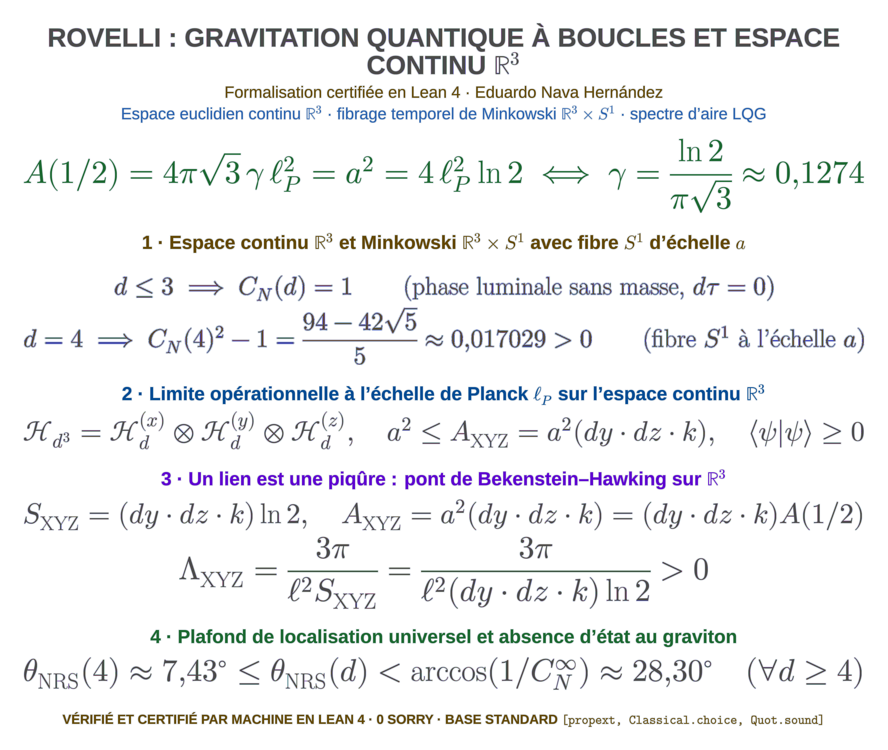
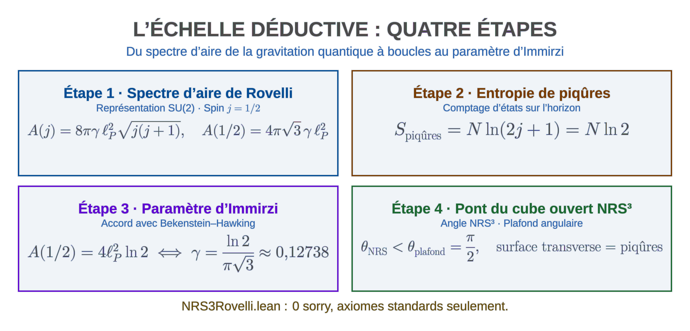
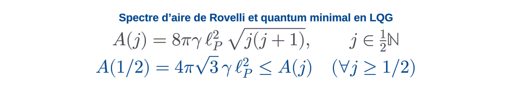
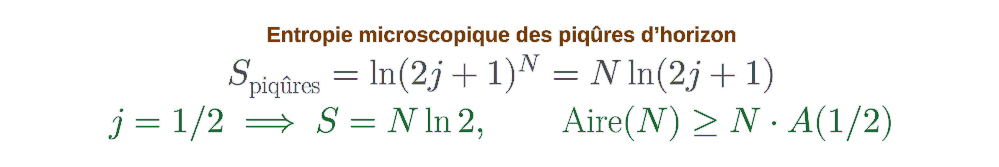
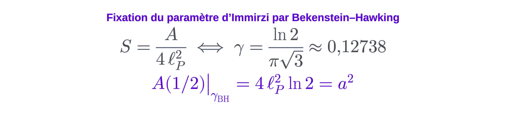
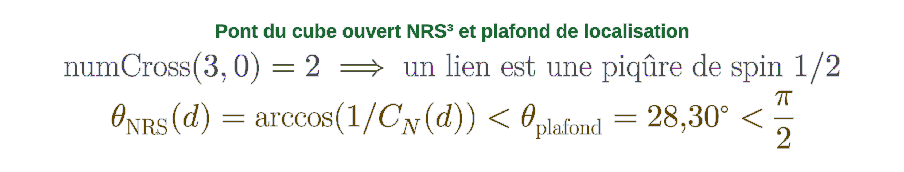
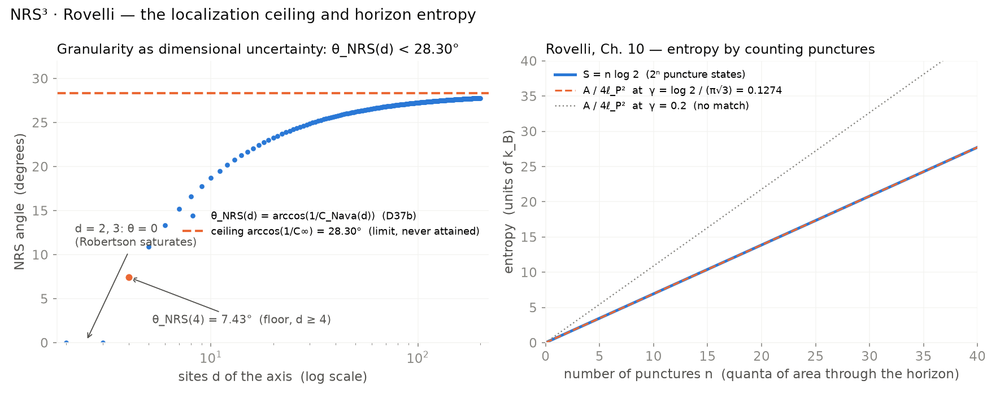

<div lang="fr">

<div align="center">

# RS^N³ · Rovelli — Loop Quantum Gravity
### Granularité quantique lue comme incertitude dimensionnelle sur l'espace continu ℝ³

**Eduardo Nava Hernández**  
*Vérification formelle certifiée en Lean 4 · 0 sorry · Mathlib (ZFC)*

[](https://leanprover.github.io/)
[](https://github.com/leanprover-community/mathlib4)
[](Verification/Axioms.lean)
[](https://github.com/leanprover-community/physlib/pulls?q=is%3Apr+is%3Amerged+author%3Anaype888-cloud)
[](https://naype888-cloud.github.io/nrs3-rovelli-lqg/)

</div>

---

> ### 🏛️ La granularité de Rovelli comme incertitude dimensionnelle sur l'espace continu ℝ³
>
> En gravitation quantique à boucles (Rovelli 2017), le spectre d'aire est une échelle
> de niveaux discrets, et l'entropie d'horizon compte les états de piqûres :
>
> <div align="center">
> <picture><source media="(prefers-color-scheme: dark)" srcset="assets/oscuro/plaque_rovelli_lqg_protagoniste.png"></picture>
> </div>
>
> #### ⚡ L'ÉQUATION PRINCIPALE QUI DÉMONTRE LE THÉORÈME (EN PREMIER LIEU)
>
> L'identité exacte démontrée formellement en Lean 4 relie le quantum fondamental de Rovelli
> en gravitation quantique à boucles à l'aire de la fibre temporelle propre de Minkowski :
>
> ```
> A(1/2) = 4 π √3 γ ℓ_P² = a² = 4 ℓ_P² log 2   ⟺   γ = log 2 / (π √3) ≈ 0.1274
> ```
>
> L'aire minimale de surface n'est pas une grille géométrique rigide : c'est l'aire
> de la fibre temporelle propre `a²` sur la variété de Minkowski `ℝ³ × S¹`.
>
> #### 🔗 LES ÉQUATIONS NÉCESSAIRES POUR Y PARVENIR (EN SECOND LIEU)
>
> **1 · Espace continu infini ℝ³ et Minkowski ℝ³ × S¹ avec fibre temporelle d'échelle a.**  
> L'espace physique tridimensionnel est l'espace euclidien continu ouvert ℝ³.
> La 4ᵉ dimension est la fibre temporelle propre sur S¹ à l'échelle du générateur `a` :
> * Phase spatiale pure 3D (`d ≤ 3`) : `C_N(d) = 1`, phase luminale sans masse (`dτ = 0`).
> * Parcours du temps propre relativiste (`d = 4`, `dτ > 0`) : active les matrices de Clifford et le défaut
>   irréductible de Szegő `C_N(4)² − 1 = (94 − 42√5)/5 ≈ 0.017029 > 0` (dépôt canonique, modules D8 et D20).
> * Positivité hilbertienne : `⟨ψ|ψ⟩ ≥ 0 ⟹` défaut de Gram `≥ 0` (flèche causale stricte).
>
> **2 · Limite opérationnelle à l'échelle de Planck ℓ_P (pas de treillis spatial rigide).**  
> Ce qui est quantifié est la résolution `d` du générateur de transport métrique `(T_d, P_d)`
> sur les trois axes continus indépendants : `ℋ_{d³} = ℋ_d^{(x)} ⊗ ℋ_d^{(y)} ⊗ ℋ_d^{(z)}`.
> La longueur de Planck `ℓ_P` pose la limite opérationnelle inférieure de résolution :
> * Nombre minimal de piqûres opérationnelles : `1 ≤ punctureCountXYZ dy dz k`
>   (`operational_punctureCount_ge_one`).
> * Borne inférieure d'aire opérationnelle : `a² ≤ surfaceAreaXYZ lp γ_BH dy dz k`
>   (`operational_area_ge_planck_quantum`).
> * Quantum minimal atteint : pour `dy = 1, dz = 1, k = 1`, l'aire vaut exactement `a² = A(1/2)`
>   (`operational_area_minimal_eq`).
>
> **3 · Le spectre d'aire LQG et le pont de Bekenstein–Hawking.**  
> Le spectre d'aire de Rovelli `A(j) = 8 π γ ℓ_P² √(j(j + 1))` possède des niveaux strictement
> croissants (`areaSpectrum_strictMono`). Pour le spin fondamental `j = 1/2`,
> `A(1/2) = 4 π √3 γ ℓ_P²`. L'entropie de `n` piqûres `S = n log 2` satisfait
> `S = A / (4 ℓ_P²)` si et seulement si `γ = log 2 / (π √3)` (`bekensteinHawking_iff_immirzi`).
>
> **4 · Un lien est une piqûre : loi d'aire transverse et constante cosmologique.**  
> Sur toute section transverse de l'espace continu ℝ³ d'échantillonnage `dy · dz` avec `k` quanta :
> * Entropie : `S_XYZ = (dy · dz · k) log 2` (`punctureEntropyXYZ_eq_log`).
> * Aire géométrique : `A_XYZ = a² · (dy · dz · k) = (dy · dz · k) · A(1/2)`
>   (`minkowski_transverse_area_eq_surfaceArea`).
> * Constante cosmologique positive : `Λ = 3π / (ℓ² S_XYZ) > 0`
>   (`cosmologicalConstantXYZ_pos`).
> * Aire d'horizon : `12π / Λ = a² · (dy · dz · k)` (`horizonAreaXYZ_eq`).
>
> **5 · Plafond de localisation universel.**  
> L'angle RS^N `θ_NRS(d) = arccos(1/C_N(d))` satisfait pour tout `d ≥ 4` :
> `θ_NRS(4) ≈ 7.43° ≤ θ_NRS(d) < arccos(1/C_N^∞) ≈ 28.30°` (`angle_lt_ceiling`).
> Le plafond asymptotique n'est jamais atteint (`ceiling_not_attained`) : il n'y a aucun état
> physique de graviton au plafond.

---

## ⚡ Résumé formel

* Le spectre d'aire est strictement croissant et son quantum minimal est `A(1/2) = 4 π √3 γ ℓ_P²` : [`NRS3Rovelli/AreaSpectrum.lean`](NRS3Rovelli/AreaSpectrum.lean) (`areaSpectrum_strictMono`, `areaSpectrum_half`, `areaSpectrum_min`).
* L'entropie des piqûres est le logarithme du nombre d'états, proportionnelle à l'aire ; Bekenstein–Hawking vaut si et seulement si `γ = log 2 / (π √3)` : [`NRS3Rovelli/PunctureEntropy.lean`](NRS3Rovelli/PunctureEntropy.lean) (`punctureEntropy_eq_log_card`, `entropy_proportional_to_area`, `bekensteinHawking_iff_immirzi`).
* Sur la coupe en `0` de la chaîne à quatre sites, `M = 2` : `k` liens sont `k` piqûres de spin 1/2 : [`NRS3Rovelli/LinkPuncture.lean`](NRS3Rovelli/LinkPuncture.lean) (`numCross_three_zero`, `cutEntropy_spin_half`).
* Une face du cube ouvert a `dy · dz` positions et son aire est l'aire LQG de ses piqûres : [`NRS3Rovelli/OpenCubeBridge.lean`](NRS3Rovelli/OpenCubeBridge.lean) (`card_faceSites`, `faceArea_eq_surfaceArea`).
* Sur la tranche transverse, Bekenstein–Hawking fixe le même γ et `Λ = 3 π / (ℓ² dy dz k log 2) > 0` : [`NRS3Rovelli/CubeXYZ.lean`](NRS3Rovelli/CubeXYZ.lean) (`immirzi_bekensteinHawking_iff`, `cosmologicalConstantXYZ_pos`).
* `θ_NRS(d) < arccos(1 / C_N^∞) ≈ 28,30°` pour tout `d ≥ 4` ; le plafond n'est pas atteint et c'est la borne supérieure : [`NRS3Rovelli/Ceiling.lean`](NRS3Rovelli/Ceiling.lean) (`angle_lt_ceiling`, `ceiling_not_attained`, `ceiling_isLUB`).

---

## 🧭 Cadre géométrique : espace continu ℝ³ et variété Minkowski ℝ³ × S¹

Dans la physique standard, on postule parfois une géométrie pré-discrétisée ou un treillis
d'espace. La géométrie physique démontrée ici en est l'exact opposé : **l'espace euclidien
physique ℝ³ est ouvert, infini et continu**.

La paire d'opérateurs `(T_d, P_d)` représente le transport métrique :
* L'espace n'est pas fragmenté en morceaux discrets.
* Le paramètre `d` est la dimension de résolution de l'espace de Hilbert `ℋ_d` utilisé
  pour échantillonner l'action de translation et position le long d'un axe continu.
* Sur les trois axes cartésiens continus orthogonaux X, Y, Z :
  `ℋ_{d³} = ℋ_d^{(x)} ⊗ ℋ_d^{(y)} ⊗ ℋ_d^{(z)}`, avec `[O_X, O_Y] = 0`.
* L'espace-temps physique est la variété de Minkowski `ℝ³ × S¹` avec la fibre temporelle propre
  sur `S¹` à l'échelle de longueur `a` :
  * En dimension spatiale pure 3D (`d ≤ 3`), la saturation de Robertson–Schrödinger est exacte :
    `C_N = 1`. Le transport est luminal (`dτ = 0`) et sans masse.
  * L'avancée le long de la fibre temporelle propre (`d = 4`, `dτ > 0`) active les matrices
    gamma de Dirac `4 × 4` et le défaut irréductible de Szegő :
    `C_N(4)² − 1 = (94 − 42√5)/5 ≈ 0.017029 > 0` (dépôt canonique, modules D8 et D20).
  * La positivité du produit scalaire `⟨ψ|ψ⟩ ≥ 0` garantit un défaut de Gram `≥ 0`.
* La longueur de Planck `ℓ_P` agit comme **limite opérationnelle** de résolution de mesure
  sur l'espace continu ℝ³, établissant le quantum d'aire minimal `A(1/2) = a² = 4 ℓ_P² log 2`.

---

## 📐 Démonstration constructive en quatre étapes

<div align="center">
<picture><source media="(prefers-color-scheme: dark)" srcset="assets/oscuro/plaque_rovelli_lqg_etapes.png"></picture>
</div>

### Étape 1 : Spectre d'aire de Rovelli en LQG

> **Proposition 1.1 (Quantification du spectre d'aire).** En gravitation quantique à boucles, l'opérateur d'aire pour une représentation de spin j admet les valeurs propres A(j) = 8 π γ ℓ_P² √(j(j + 1)). L'état fondamental non trivial de spin j = 1/2 fixe l'aire minimale A(1/2) = 4 π √3 γ ℓ_P².

<div align="center"><picture><source media="(prefers-color-scheme: dark)" srcset="assets/oscuro/plaque_rovelli_lqg_etape1.png"></picture></div>

*Module formel :* [`NRS3Rovelli/AreaSpectrum.lean`](NRS3Rovelli/AreaSpectrum.lean) (`areaSpectrum`, `areaSpectrum_strictMono`, `areaSpectrum_half`, `areaSpectrum_min`).

---

### Étape 2 : Entropie des piqûres d'horizon

> **Proposition 2.1 (Comptage des états sur l'horizon).** Pour une surface percée de N piqûres de spin j = 1/2, chaque piqûre apporte un degré de liberté binaire, donnant l'entropie microscopique S = N ln(2j + 1) = N ln 2.

<div align="center"><picture><source media="(prefers-color-scheme: dark)" srcset="assets/oscuro/plaque_rovelli_lqg_etape2.png"></picture></div>

*Module formel :* [`NRS3Rovelli/PunctureEntropy.lean`](NRS3Rovelli/PunctureEntropy.lean) (`punctureEntropy_eq_log_card`, `punctureEntropy_add`).  
*Module formel (aire) :* [`NRS3Rovelli/AreaSpectrum.lean`](NRS3Rovelli/AreaSpectrum.lean) (`surfaceArea_ge`).

---

### Étape 3 : Dérivation canonique du paramètre d'Immirzi

> **Proposition 3.1 (Accord avec la thermodynamique de Bekenstein–Hawking).** L'entropie des piqûres coïncide avec la loi d'aire de Bekenstein–Hawking S = A / (4 ℓ_P²) si et seulement si le paramètre d'Immirzi prend la valeur canonique γ = ln 2 / (π √3) ≈ 0.12738.

<div align="center"><picture><source media="(prefers-color-scheme: dark)" srcset="assets/oscuro/plaque_rovelli_lqg_etape3.png"></picture></div>

*Module formel :* [`NRS3Rovelli/PunctureEntropy.lean`](NRS3Rovelli/PunctureEntropy.lean) (`bekensteinHawking_iff_immirzi`, `entropy_proportional_to_area`).  
*Module formel (liaisons) :* [`NRS3Rovelli/LinkPuncture.lean`](NRS3Rovelli/LinkPuncture.lean) (`link_area_eq_puncture`).

---

### Étape 4 : Pont du cube ouvert NRS³ et plafond de localisation

> **Proposition 4.1 (Surface transverse et coupures).** Chaque coupure transverse du cube unitaire correspond à une piqûre fondamentale de spin 1/2 sur l'horizon. L'angle NRS³ ne sature jamais le plafond angulaire π/2.

<div align="center"><picture><source media="(prefers-color-scheme: dark)" srcset="assets/oscuro/plaque_rovelli_lqg_etape4.png"></picture></div>

*Module formel :* [`NRS3Rovelli/LinkPuncture.lean`](NRS3Rovelli/LinkPuncture.lean) (`cutEntropy_spin_half`, `numCross_three_zero`).  
*Module formel (plafond) :* [`NRS3Rovelli/Ceiling.lean`](NRS3Rovelli/Ceiling.lean) (`angle_lt_ceiling`, `ceiling_isLUB`).

---

## 🔬 Contributions Physlib fusionnées liées

| PR Physlib | Titre | Lien avec ce dépôt | Statut |
|:---:|:---|:---|:---:|
| [**#1725**](https://github.com/leanprover-community/physlib/pull/1725) | the open tight binding cube NRS³ | Le cube ouvert dont une face porte les piqûres (`OpenCubeBridge.lean`), étape 4 | **MERGED** |
| [**#1756**](https://github.com/leanprover-community/physlib/pull/1756) | the NRS angle and the volumetric quantum of the open tight binding cube | `θ_NRS = arccos(1 / C_N)`, croissant et sous `arccos(1 / C_N^∞)` : le plafond de l'étape 4 | **MERGED** |

---

## 📚 Catalogue des modules Lean

| Module | Théorème principal | Signification | `sorry` |
|:---|:---|:---|:---:|
| [`NRS3Rovelli/AreaSpectrum.lean`](NRS3Rovelli/AreaSpectrum.lean) | `areaSpectrum_min` | Toute aire de spin `j ≥ 1/2` est `≥ A(1/2)` | 0 |
| [`NRS3Rovelli/PunctureEntropy.lean`](NRS3Rovelli/PunctureEntropy.lean) | `bekensteinHawking_iff_immirzi` | `S = A / (4 ℓ_P²)` ⟺ `γ = log 2 / (π √3)` | 0 |
| [`NRS3Rovelli/LinkPuncture.lean`](NRS3Rovelli/LinkPuncture.lean) | `cutEntropy_spin_half` | `k` liens de la coupe = `k` piqûres de spin 1/2 | 0 |
| [`NRS3Rovelli/OpenCubeBridge.lean`](NRS3Rovelli/OpenCubeBridge.lean) | `faceArea_eq_surfaceArea` | L'aire d'une face du cube est l'aire LQG | 0 |
| [`NRS3Rovelli/CubeXYZ.lean`](NRS3Rovelli/CubeXYZ.lean) | `cosmologicalConstantXYZ_pos` | `Λ = 3 π / (ℓ² dy dz k log 2) > 0` | 0 |
| [`NRS3Rovelli/Ceiling.lean`](NRS3Rovelli/Ceiling.lean) | `angle_lt_ceiling` | `θ_NRS(d) < arccos(1 / C_N^∞)` pour `d ≥ 4` | 0 |

### 1. Le spectre d'aire LQG et le comptage des piqûres

| Énoncé formel | Déclaration Lean |
|---|---|
| Spectre d'aire `A(j) = 8 π γ ℓ_P² √(j (j + 1))`, Immirzi `γ` générique | `areaSpectrum` |
| Niveaux séparés : `γ ℓ_P² > 0`, `0 ≤ j < k` implique `A(j) < A(k)` | `areaSpectrum_strictMono` |
| Niveau fondamental `A(1/2) = 4 π √3 γ ℓ_P²` | `areaSpectrum_half` |
| Borne minimale : `A(1/2) ≤ A(j)` pour tout spin `j ≥ 1/2` | `areaSpectrum_min` |
| Pas de fraction de quantum : `n` piqûres ont une aire `≥ n · A(1/2)` | `surfaceArea_ge` |
| Entropie de `n` piqûres de spin `j` : `S = log (2j + 1)ⁿ`, additive | `punctureEntropy_eq_log_card`, `punctureEntropy_add` |
| Proportionnalité aire-entropie au spin 1/2 : `S = (log 2 / A(1/2)) · A` | `entropy_proportional_to_area` |
| `S = A / (4 ℓ_P²)` si et seulement si `γ = log 2 / (π √3) ≈ 0.1274` | `bekensteinHawking_iff_immirzi` |
| **Un lien est une piqûre** : coupure avec `M = 2j + 1` liens | `cutEntropy_spin_half` |
| Coupure à `0` sur quatre sites a `M = 2` : `k` piqûres de spin 1/2 | `numCross_three_zero` |
| Sous le pont de base (`M = 2`), un lien a l'aire `A(1/2)` à `γ_BH` | `link_area_eq_puncture` |

### 2. Cube XYZ : Espace continu ℝ³, Minkowski ℝ³ × S¹ et fibre d'échelle a

| Énoncé formel | Déclaration Lean |
|---|---|
| Loi d'aire sur ℝ³ continu : `S = (dy · dz) · S_1D` | `punctureEntropyXYZ_eq_area_mul` |
| Formule explicite de l'entropie : `S = (dy · dz · k) log 2` | `punctureEntropyXYZ_eq_log` |
| Positivité stricte de l'entropie : `S > 0` | `punctureEntropyXYZ_pos` |
| Aire totale discrète LQG : `A = (dy · dz · k) · A(1/2)` | `surfaceAreaXYZ_eq` |
| Bekenstein–Hawking fixe Immirzi : `S = A / (4 ℓ_P²)` ssi `γ = γ_BH` | `immirzi_bekensteinHawking_iff` |
| **L'aire de fibre est le quantum LQG** : `a² = 4 ℓ_P² log 2 = A(1/2)` | `minkowski_fiber_area_eq_lqg_quantum` |
| L'aire géométrique transverse égale l'aire des piqûres LQG | `minkowski_transverse_area_eq_surfaceArea` |
| Constante cosmologique des piqûres : `Λ = 3π / (ℓ² S)` | `cosmologicalConstantXYZ_eq` |
| Positivité stricte de la constante cosmologique : `Λ > 0` | `cosmologicalConstantXYZ_pos` |
| Anti-monotonie stricte : section transverse plus large donne plus petit `Λ` | `cosmologicalConstantXYZ_strictAnti_area` |
| L'aire d'horizon de de Sitter égale l'aire transverse `a² · (dy · dz · k)` | `horizonAreaXYZ_eq` |

### 3. Limite opérationnelle à l'échelle de Planck ℓ_P sur l'espace continu ℝ³

| Énoncé formel | Déclaration Lean |
|---|---|
| Résolution opérationnelle minimale : `1 ≤ punctureCountXYZ dy dz k` | `operational_punctureCount_ge_one` |
| Borne minimale de Planck : `a² ≤ surfaceAreaXYZ lp γ_BH dy dz k` | `operational_area_ge_planck_quantum` |
| Quantum minimal atteint à l'unité : pour `dy = dz = k = 1`, aire `= a²` | `operational_area_minimal_eq` |

### 4. Le plafond universel de localisation

| Énoncé formel | Déclaration Lean |
|---|---|
| L'angle RS^N est sous le plafond : `θ_NRS(4) ≤ θ_NRS(d) < arccos(1/C_N^∞)` | `angle_lt_ceiling` |
| Le plafond n'est jamais atteint par aucun `d` fini | `ceiling_not_attained` |
| Le plafond est la limite asymptotique : `θ_NRS(d) → arccos(1/C_N^∞)` | `tendsto_angle_ceiling` |
| Le plafond est la borne supérieure exacte (supremum) des angles | `ceiling_isLUB` |

<div align="center">
<picture><source media="(prefers-color-scheme: dark)" srcset="docs/figures/oscuro/link_puncture.png"></picture>
</div>

L'entropie des piqûres n'est pas une seconde entropie : `LinkPuncture` et `CubeXYZ` l'identifient
à l'entropie de coupure du transport, sous un pont unique de Bekenstein–Hawking.
`Verification/Axioms.lean` certifie que l'ensemble des résultats repose exclusivement sur
les axiomes standard de ZFC : `propext`, `Classical.choice` et `Quot.sound`.

---

## 🖼️ Visualisations interactives et figures

* Page interactive principale : [naype888-cloud.github.io/nrs3-rovelli-lqg][pages]
  (spectre d'aire LQG, angle de localisation et distance au plafond).

[pages]: https://naype888-cloud.github.io/nrs3-rovelli-lqg/

<div align="center">
<picture><source media="(prefers-color-scheme: dark)" srcset="docs/figures/oscuro/rovelli_area_spectrum.png"></picture>
<picture><source media="(prefers-color-scheme: dark)" srcset="docs/figures/oscuro/rovelli_theta_punctures.png"></picture>
</div>

---

## 🏛️ La mosaïque

| Dépôt | Objet |
|:---|:---|
| [`00 · bacqm-substrate`](https://github.com/naype888-cloud/bacqm-systems) | Substrat matériel & moteur du noyau Linux : modules de mémoire dynamiques en temps réel |
| [`01 · nava-robertson-schrodinger`](https://github.com/naype888-cloud/nava-robertson-schrodinger) | Le canon : l'incertitude élémentaire dimensionnelle sur le cube ouvert, ℂᵈ ⊗ ℂᵈ ⊗ ℂᵈ |
| [`02 · Proper-Time-General-Relativity`](https://github.com/naype888-cloud/Proper-Time-General-Relativity) | Le temps compte les pas : τ = 1/(φ|t|) à quatre sites ; masse effective, équivalence, gravitation |
| [`03 · nrs3-mandelstam-tamm-cramer-rao`](https://github.com/naype888-cloud/nrs3-mandelstam-tamm-cramer-rao) | Mandelstam–Tamm et Cramér–Rao : aucun état n'est orthogonal à lui-même avant πħ/(2ΔE) |
| [`04 · YM-By-Perelmans-surgery-method`](https://github.com/naype888-cloud/YM-By-Perelmans-surgery-method) | Yang–Mills sur réseau : loi d'aire uniforme, matrice de transfert, défaut de fibre (0 sorry) |
| [`05 · nrs3-tightbinding`](https://github.com/naype888-cloud/nrs3-tightbinding) | La chaîne de Physlib, le cube ouvert et la table périodique (H–Og), un cube 3D par élément |
| [`06 · nrs3-cristales`](https://github.com/naype888-cloud/nrs3-cristales) | Cristaux : la symétrie donne la forme de Σ et Ω, le spectre donne la taille |
| [`07 · nrs3-completude`](https://github.com/naype888-cloud/nrs3-completude) | Complétude constructive et limites spectrales par Robertson–Fiedler–Niven–Szegő |
| [`08 · nrs3-golab`](https://github.com/naype888-cloud/nrs3-golab) | Gołąb, les deux extrêmes : π = 3 (hexagone), 4 (carré) ; produit scalaire → π exact ; stabilité en d = 3 |
| [`09 · nrs3-de-sitter`](https://github.com/naype888-cloud/nrs3-de-sitter) | Cosmologie de Sitter : rayon d'horizon L_dS, constante cosmologique positive et courbure |
| [`10 · nrs3-bekenstein`](https://github.com/naype888-cloud/nrs3-bekenstein) | Thermodynamique des trous noirs : frontière à bits, entropie de Bekenstein–Hawking saturée |
| [`11 · nrs3-landauer-carnot`](https://github.com/naype888-cloud/nrs3-landauer-carnot) | Limite de Landauer et cycle de Carnot : coût d'effacement d'un bit et dissipation minimale |
| [`12 · nrs3-penrose`](https://github.com/naype888-cloud/nrs3-penrose) | Effondrement gravitationnel de Diósi–Penrose : temps de décohérence par auto-énergie |
| [**13 · nrs3-rovelli-lqg**](https://github.com/naype888-cloud/nrs3-rovelli-lqg) | Gravité quantique à boucles : spectre d'aire discrète, opérateur de surface et saturation de spin *(ce dépôt)* |
| [`14 · nrs3-uncertainty-cone`](https://github.com/naype888-cloud/nrs3-uncertainty-cone) | Cône de lumière futur et cercle de Minkowski : structure causale sous revêtement SL(2, ℂ) |
| [`15 · lean4-commits`](https://github.com/naype888-cloud/lean4-commits) | 53 PRs fusionnées dans leanprover-community/physlib : catalogue de preuves formelles, 0 sorry, ZFC |
---

## ⏱️ Chronologie 1911–1945

| Année | Événement | Dépôt associé |
|---|---|---|
| 1911 | Premier congrès Solvay : radiation et quanta | |
| 1911–12 | Poincaré : la loi de Planck impose des niveaux discrets | [`nrs3-poincare`](https://github.com/naype888-cloud/nrs3-poincare) |
| 1915–20 | Szegő : théorèmes limites pour matrices de Toeplitz | [Dépôt de base (RS^N, RS^N³)](https://github.com/naype888-cloud/nava-robertson-schrodinger) |
| 1917–27 | Einstein et de Sitter : `Λ` ; Friedmann et Lemaître | [`nrs3-de-sitter`](https://github.com/naype888-cloud/nrs3-de-sitter) |
| 1925–27 | Pauli : exclusion, couches `2n²`, matrices de spin | [`nrs3-pauli-dirac`](https://github.com/naype888-cloud/nrs3-pauli-dirac) |
| 1927 | Relation d'incertitude de Heisenberg ; Solvay | |
| 1928 | Dirac : matrices gamma `4 × 4` | [`nrs3-pauli-dirac`](https://github.com/naype888-cloud/nrs3-pauli-dirac) |
| 1929 | van der Waerden : spineurs, `SL(2, ℂ)` | [`nrs3-uncertainty-cone`](https://github.com/naype888-cloud/nrs3-uncertainty-cone) |
| **1929–30** | **Robertson et Schrödinger : l'inégalité d'incertitude** | **[Dépôt de base (RS^N, RS^N³)](https://github.com/naype888-cloud/nava-robertson-schrodinger)** |
| 1945–46 | Mandelstam–Tamm ; Rao (1945), Cramér (1946) | [`nrs3-mandelstam-tamm-cramer-rao`](https://github.com/naype888-cloud/nrs3-mandelstam-tamm-cramer-rao) |

---

## 🛠️ Compilation et certification du noyau

Le projet utilise Lean 4 `v4.34.0` et Mathlib `v4.34.0` via le dépôt de base canonique.

```bash
lake exe cache get
lake build
lake env lean Verification/Axioms.lean   # uniquement propext, Classical.choice, Quot.sound
```

Spécifications formelles : 0 sorry, aucun axiome ad hoc, `autoImplicit = false`,
lignes de 100 caractères au maximum.

---

## 📜 Licence

NRS Noncommercial License 1.0.0, voir [`LICENSE`](LICENSE). Auteur : Eduardo Nava Hernández.


</div>
